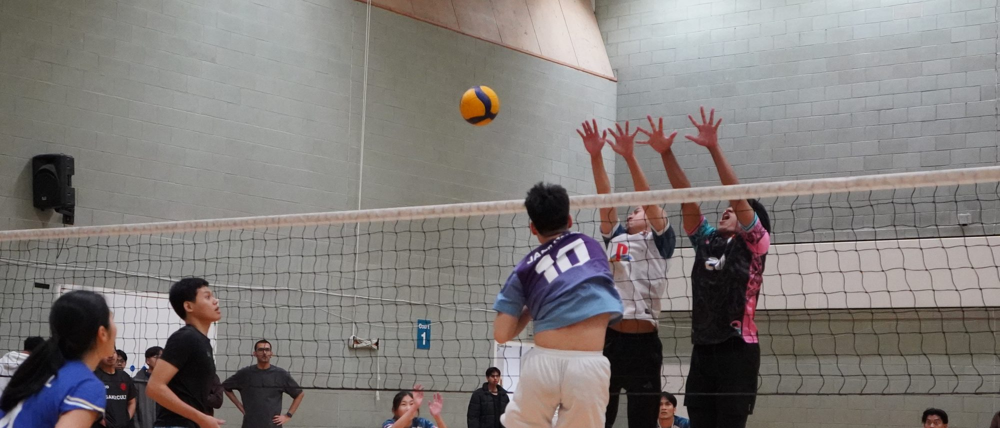

<p align="center">
  
</p>

<h1 align="center">Manchester MGames 2026</h1>

<p align="center">
  The website that ran a one-day, eight-sport tournament for the Malaysian Students' Society of Manchester.<br>
  <a href="https://manchestermgames.com"><b>manchestermgames.com</b></a>
</p>

---

On Saturday 24 October 2026, 157 teams played 310 matches across three venues in Manchester:
football, basketball, netball, volleyball, badminton, table tennis, pickleball and frisbee.
Every one of those scores went through this site, entered courtside on a phone by the head of
each sport and shown to everyone else a second later.

There was no printed draw sheet to chase, and no WhatsApp group asking "who's in the semi?".
Players checked their phones.

## The day in numbers

|                     |                                                |
| ------------------- | ---------------------------------------------- |
| **1,506**           | people used the site on match day              |
| **17,902**          | pages viewed that day, about 12 each           |
| **310 / 310**       | matches scored live, 08:30 to 19:18            |
| **6,874**           | points and goals recorded                      |
| **683,581**         | requests served, peaking at 75k in one hour    |
| **90%**             | of visitors were on a phone                    |
| **15+**             | countries, including family watching from Malaysia |

## What it does

**For everyone at the event.** No account and no app to install.

- **Schedule.** Every match, filterable by sport, venue and stage. Live games update in place.
- **Standings.** Group tables are worked out from the results using the rulebook's tie-breakers:
  head-to-head, then forfeits, then score difference. A tie the rules can't break is flagged for
  the head of sport rather than guessed. A Winners summary at the top shows 1st, 2nd and 3rd in
  every sport.
- **Knockouts fill themselves in.** "Winner QF1" becomes a real team the moment QF1 finishes.
  This includes penalty shoot-outs, basketball overtime and forfeits.
- **Follow your team.** Pick a team and the site shows only their games, then sends a push
  notification at kick-off, at full time, and if their court is running late.
- **Food, venues, info.** Stalls with menus and prices, walking times between venues, contacts
  for each venue and how to get there.

**For the committee.**

- **Court sheet** (`/coordinate`). Each head of sport signs in and sees only their courts. They
  can start a game, tap the score up, end it, award a forfeit, or record penalties.
- **Delays handle themselves.** When a court runs late, every game after it on that court shifts
  to match, and followers of those teams are told.
- **Mistakes can be undone.** Wrong score, wrong start time or wrong winner can all be fixed
  after the fact, and the brackets downstream recalculate.

Only the head of each sport can change that sport's scores. This is enforced by the database's
row-level security, not by hiding buttons, so a netball account can't touch a football result
even with a forged request.

## Built with

[Next.js 16](https://nextjs.org) · [Supabase](https://supabase.com) (Postgres, Auth, Realtime) ·
[Vercel](https://vercel.com) · Web Push · CSS Modules

No UI framework and no component library: the styling is plain CSS over a small set of design
tokens.

## Running it locally

```bash
npm install
cp .env.example .env.local   # Supabase URL + keys, VAPID keys for push
npm run dev                  # http://localhost:3000
```

To rehearse match day without touching real data, replay it in memory at a point in the day:

```bash
MGAMES_DEMO=midday npm run dev   # also: eve, morning, post
```

Nothing is written to the database, and demo mode is switched off on every Vercel deployment.

```bash
npm test             # standings, tie-breaks, brackets, delays, BST/GMT edge cases
npm run lint
npx tsc --noEmit
```

The tests focus on the logic where a bug would be quietly wrong rather than obviously broken:
who goes through, who gets a medal, and what time a delayed game actually starts.

## Where things live

```
src/app/            pages: schedule, standings, match, team, food, venues, info, coordinate
src/lib/
  standings.ts      group tables + rulebook tie-breaks
  progression.ts    fills knockout slots from earlier results
  deciders.ts       penalties, overtime and forfeits
  delays.ts         pushes a late court's later games back
  medals.ts         podiums and the winners summary
  actions/          server actions: scoring, forfeits, announcements, push
supabase/           schema migrations, RLS policies, seed data
tools/              turns the organisers' schedule spreadsheet into fixtures
tests/              Node's built-in test runner, no framework
```

The schedule came from a spreadsheet the committee kept editing until the week of the event.
`tools/extract-schedule.py` reads it, checks every group pairing plays exactly once, and
generates the fixtures. Re-running it after each new version kept the site matching the sheet
exactly.

## Credits

Built by [Adam Hazmi](https://github.com/adamhzmii) for MGames 2026, run by the
**Malaysian Students' Society of Manchester**.

Thanks to the heads of sport who scored every game, the committee and volunteers,
and our sponsors: **SGN**, **MABECS** and **UKEC**.
